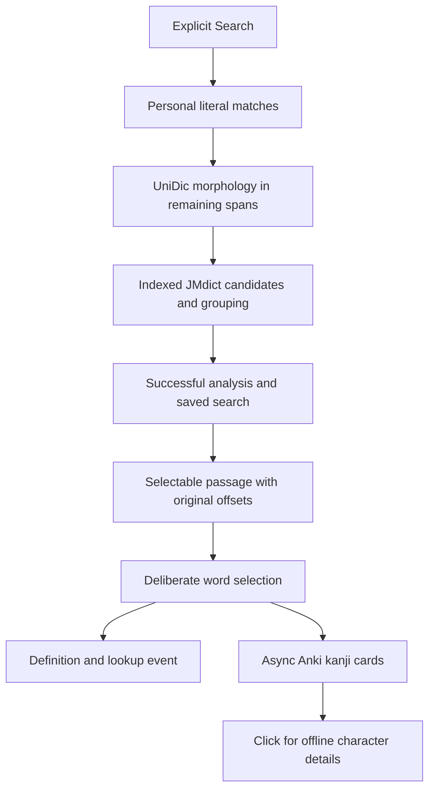

# Gengo: how the program works

This is the implementation walkthrough. Start with the [user's guide](USER-GUIDE.md)
for everyday use. [DESIGN.md](DESIGN.md) records product behavior and planned
acceptance criteria; [IMPLEMENTATION.md](IMPLEMENTATION.md) records experiments,
revisions, measured checks and gaps. Proposed design sections are not all shipped.

## Four separate data paths

Gengo is C#/.NET 10 WPF, with no browser frontend or hosted backend.

| Path | Responsibility | Where |
| --- | --- | --- |
| Word reference data | Readings, senses, labels and Common/JLPT memberships | Replaceable reference SQLite and UniDic files |
| Character reference data | On/Kun/nanori, meanings, strokes and grade | Verified KANJIDIC2 archive embedded in Infrastructure |
| Personal data | Overrides, rich definitions, settings, searches and clicks | Separate personal SQLite |
| Optional Anki data | Exact kanji keywords | Read-only HTTP calls to local AnkiConnect |

Anki is not required for ordinary word or character dictionary definitions. Gengo
does not import an Anki collection, synchronize AnkiWeb, or read Anki review history.
Its lookup statistics come from Gengo actions, not from Anki Stats.

## From Search to selectable results

The WPF handler in `src/Kotoba.App/MainWindow.xaml.cs` takes
the submitted text, asks for approval above 5,000 Unicode scalar values and starts
an asynchronous analysis. Typing alone does not analyze. Cancellation and failure
leave the previous successful result/history intact.

`src/Kotoba.Core/AnalysisEngine.cs` first places longest literal
personal expressions. It parses remaining text through
`src/Kotoba.Infrastructure/UniDicMorphology.cs`, which adapts
NMeCab/UniDic fields into tokens and restores original UTF-16 offsets. Source text
is never replaced by readings or display spaces.

Grouping considers dictionary matches over bounded token spans, with reading and
part-of-speech evidence. It can prefer dictionary-validated verb roots, recognize
some potential forms, extend auxiliary chains, and attach attributive な to a
validated na-adjective. This is not an unrestricted longest-substring lookup.
Unknown tokens remain available without invented definitions. See
[Dictionary and analysis](dictionary-and-analysis.md) for limitations.

The rendered passage has source Runs plus display-only gaps. Selection mapping
reconstructs source text, keeping intentional spaces/newlines and omitting inserted
gaps. Choosing a word updates selection and definitions rather than rebuilding
the entire passage. The first candidate is a ranking choice, not a sentence-level
semantic disambiguation guarantee.

## Readings and definitions

`src/Kotoba.App/MainWindow.Entry.cs` constructs the selected
entry's headword, senses, restrictions, notices, other forms and alternatives.
Dictionary senses remain available even when a specific sense applies only to
another form; restrictions label that distinction. Duplicate current form/reading
pairs are removed from Other forms.

`src/Kotoba.App/RubyAdorner.cs` draws passage readings above kanji
segments. `src/Kotoba.App/NaturalRuby.cs` lays out dictionary
headword readings at normal glyph proportions, distributing spacing across the
shared spelling width. Long readings reduce size uniformly when needed; they do
not stretch horizontally. Font fallback/text-engine differences can still affect
appearance. Ruby is display support, not a reading proof for every literary name.

Entries adapt to available width and reading size, using a divider between
headword and meanings or stacking them at narrow widths. Native read-only text
controls preserve selection/copy. Clipboard export formats Anki bracket notation;
it has no connection to Anki's note-creation API.

## Personal overrides and rich definitions

`src/Kotoba.Infrastructure/PersonalStore.cs` enforces a unique
expression across both categories. Category changes preserve entry ID. Filtering
the personal list does not change which entries participate in analysis. Save
reanalyzes the active passage without adding a search or click.

The definition editor uses native WPF commands for bold, italic and lists.
`src/Kotoba.App/DefinitionFormatting.cs` saves an RTF
document as base64 alongside its plain text. Subscript uses Typography.Variants;
Small note uses smaller text on the baseline. Results load a read-only formatted
document, scaled with reading size. Missing/malformed supported formatting falls
back to the plain definition. The app loads RTF, not arbitrary XAML from entries.

Personal expressions/readings are limited to 2,000 characters; definition/notes to
20,000 each; encoded formatting to 400,000. Entries are global literal overrides.
Category and usage-note wording are organizational metadata, not matching rules.

## Grammar: two mechanisms

Word-form explanations come from recognized morphological endings: passive,
potential, causative, negative, past, polite, connective/conditional and selected
auxiliary uses. Ambiguities such as passive/potential/honorific are retained.

`src/Kotoba.Core/GrammarEngine.cs` separately scans the full
existing analysis with the `builtin-1` catalog. Some rules inspect token/clause
context; others match explicit constructions. Cards hold pattern names, authored
English explanations, uncertainty and one or more source spans. The UI can
highlight separated components such as しか and a negative predicate.

No model is loaded or called. A zero-card result means no implemented rule matched,
not that the sentence lacks grammar. Coverage is still the prototype milestone;
broader literary interpretation and the design's optional model mode are unfinished.

## Recording and counting actions

Successful intentional submissions save text and serialized analysis with resource
versions. Definition openings save entry identity, root/reading, clicked surface,
timestamp and optional submitted-passage link.
`src/Kotoba.Core/LookupSelection.cs` suppresses repeated opens
of the already-selected entry; A → B → A permits another A event. A new search
clears that identity. Rendering, font changes, grammar and history inspection do
not produce click events.

Statistics group by entry ID within local-calendar date bounds and show entries
with at least five events. Through dates are inclusive, implemented as the next
local midnight exclusive; daylight-saving days can be 23 or 25 hours. Daily totals
are derived from lookup timestamps. This is not an Anki-style 4 AM study-day cutoff.
History pages contain 30 searches; lookup detail queries are bounded, and the UI
limits the number of daily/detail rows it shows. Persistent history is not expired
automatically.

## Storage and recovery

Default root: `%LOCALAPPDATA%\Kotoba`, retained after the Gengo rename.
`KOTOBA_DATA_DIR` replaces that root for isolated sessions. Application binaries
remain in the published folder and are not the data directory.

| Personal table | Stored data |
| --- | --- |
| `personal` | Stable ID, expression, reading, plain definition, notes, category, encoded RTF |
| `searches` | Original text, timestamp and serialized analysis |
| `clicks` | Entry identity, root/reading/surface, timestamp and nullable search link |
| `settings` | Font size and Anki mapping values |

Schema 2 migrates schema 1 only after a unique SQLite safety snapshot is created.
The migration adds category/default Personal words and empty formatting without
rewriting historical text. New databases start at schema 2. A higher schema is
rejected rather than treated as compatible.

Backup uses SQLite's snapshot API, then creates a ZIP containing `personal.sqlite`
and a versioned manifest with date, counts and reference-version information.
Restore checks archive shape, integrity, supported schema, counts, required columns,
foreign keys and saved text spans before replacing the active database. It creates
a safety ZIP, restores personal data, migrates older schemas and refreshes UI state.
Reference resources are omitted and remain separately installed. Backup is a
replacement operation, not a merge or cloud sync.

## Keeping the window responsive

Morphology/indexing and substantial database work run outside the UI thread.
Anki calls are asynchronous, canceled when selection changes and independent of
word definitions. Reference caches are bounded. KANJIDIC2 initializes once on a
worker, then uses an immutable character index.

The passage ruby drawing is cached. Size/scroll changes coalesce a rebuild rather
than triggering an unconditional LayoutUpdated/render cycle. An earlier version
used a continuous layout/render loop; the fix and measurements are recorded in
[IMPLEMENTATION.md](IMPLEMENTATION.md). Native UI checks guard idle redraws/CPU,
selection, ruby proportions and compact/tall layouts. Timing checks can be affected
by startup activity and concurrent load; zero repeated rendering is checked separately.

## Networking and packaging

Explicit resource installation fetches pinned public archives over HTTPS and
checks SHA-256 before import. A staged version becomes active only after success;
cancellation preserves the old resource pointer. Manual resource checking probes
the supported release, not upstream latest or app updates. Passage text is not
included in dictionary requests. Optional Anki traffic goes only to loopback.

The app publishes as a self-contained Windows x64 folder. DLLs, license notices,
README and these guides accompany it; runtime/dependency files must stay together.
No single-file bundling hides the replaceable NMeCab library. See
[Repository structure](repository-structure.md), [Tools used](tools-used.md) and
[Development workflow](development-workflow.md) for reproducible source work.
